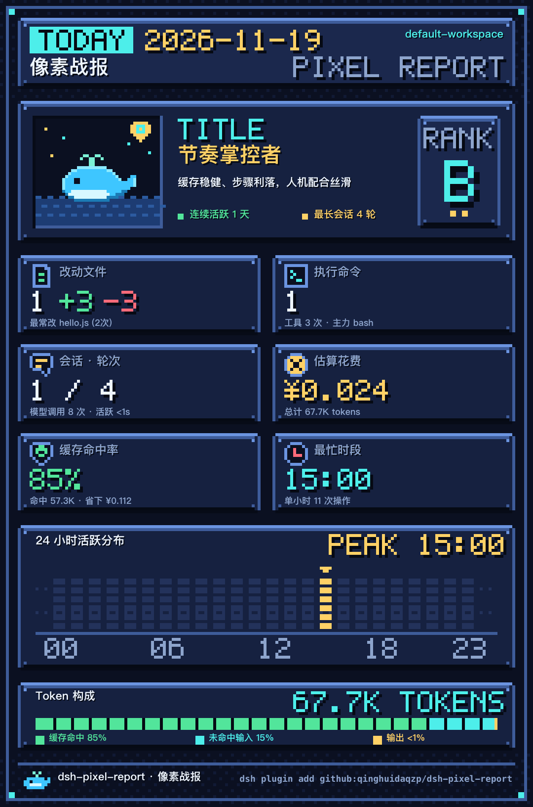
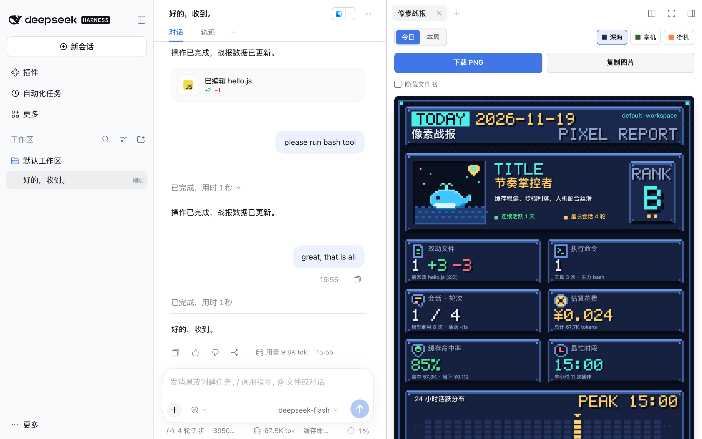

# dsh-pixel-report · Pixel Report

English | [中文](README.md)

A DeepSeek Harness (`dsh`) right-sidebar plugin that turns what your agent did today (or over the last 7 days) into a **shareable retro pixel-art battle report card** (1080×1632 portrait PNG), with one-click PNG download and clipboard copy.





Screenshots were captured from a real `dsh` (`0.2.2-rc.1`) Web instance backed by the local DeepSeek stand-in (`test/mockseek.mjs`), executing real `write`, `edit`, and `bash` tool calls.

## What goes on the card

Every number comes from real observed activity — no placeholder or randomized stats:

- **Pixel whale mascot & RPG rank**: Deterministic grade (`S+`, `S`, `A`, `B`, `C`, or `ZZZ` when idle), themed pixel accessory, and earned title (e.g. *Night Owl Engineer*, *Refactor Maniac*, *Cache Whisperer*, *Terminal Warlord*).
- **Files & lines changed**: Count of modified files, `+added / -deleted` line totals, and most-edited filename (basename only by default).
- **Commands & tools**: Shell commands executed (`bash`, `pwsh`, `terminal`, etc.), total tool calls, and top tool.
- **Sessions & turns**: Active session count, turns completed, model requests, active turn duration, consecutive active-day streak, and longest session.
- **Cost & cache savings**: Estimated CNY cost using DeepSeek's peak/off-peak list prices, prompt cache hit rate, money saved by the cache, and a segmented Token Mix bar.
- **Activity bar chart**: 24-hour pixel LED bar chart with highlighted peak hour in **Today** mode, and a 7-day trend chart in **7 Days** mode.
- **3 retro themes**: DeepSea (`midnight`), GameBoy (`gameboy`), and Arcade (`arcade`).
- **One-click export**: Download full-resolution 1080×1632 PNG or copy directly to clipboard (with graceful fallback notice if clipboard image write is restricted).

## How it collects data

The host plugin passively observes three read-only hooks without mutating requests or tool results:

- `llm/stream`: Reads `usage` chunks (`inputTokens`, `cacheReadTokens`, `cacheWriteTokens`, `outputTokens`) and prices them with `lib/pricing.js`.
- `tools/result`: Counts executed tool calls (ignoring pre-dispatch denials/cancellations), shell commands, and file edits (`write`, `edit`, `apply_patch`, `str_replace_editor`) with line diffs.
- `session/event`: Tracks `turn/start` and `turn/end` counts/durations. When `@deepseek-ai/dsh-workspace-changes` is loaded, it also listens to `workspace/changes` to include shell/git-modified files and net line counts without double-counting file-tool edits.

Daily buckets (90 days retained, keyed by local calendar date) are persisted to `pixel-report/stats.json` under your dsh home directory and exposed to the Web tab via the `pixelReport` Typert RPC service.

## Privacy

- All data stays local; the plugin makes no network requests.
- **No full paths persisted**: `stats.json` stores only a short path hash plus the file basename — never directory paths, conversation content, file contents, or shell command arguments.
- Toggle **Hide names** in the sidebar (or set `hideNames: true` in config) to omit filenames and workspace names from the rendered card entirely.

## Installation

Requires `dsh` ≥ 0.2.0 (verified on `0.2.2-rc.1`).

```bash
dsh plugin --profile web add github:qinghuidaqzp/dsh-pixel-report
```

Restart dsh, open the right sidebar, and pick **Pixel Report** (**像素战报**).

## Configuration

```yaml
- id: pixel-report
  config:
    hideNames: false
    peakPricing: true
    prices: []
```

| Key | Default | Description |
|---|---|---|
| `stateFile` | `pixel-report/stats.json` in dsh home | Persistence path; leave empty for memory-only |
| `hideNames` | `false` | Hide filenames and workspace names on the card by default |
| `peakPricing` | `true` | Double prices during Beijing weekday peak hours (9–12, 14–18) |
| `prices` | `[]` | Custom price rows (`match`, `label`, `hit`, `miss`, `output` in CNY / 1M tokens) |

## Verification & Limitations

- **Verified**: Unit tests (`node --test`) for pricing, line diff, deterministic rank rules, timezone buckets, privacy masking, and `workspace/changes` reconciliation; real `dsh 0.2.2-rc.1` headless integration test (`write` + `edit` + `bash`); real `dsh 0.2.2-rc.1` Web UI verified in headless Chrome (tab mount, live RPC updates, Today/7-Day switch, 3 themes, privacy toggle, 1080×1632 PNG export).
- **Not directly verified**: Clipboard `ClipboardItem` image write across restricted browser origins/desktop webviews (falls back gracefully to telling the user to use Download PNG); live DeepSeek API billing (tested against `test/mockseek.mjs`).
- Counts only activity inside dsh; cost numbers are list-price estimates (weekday statutory holidays are not modelled).

## Development

```bash
npm install
npm test
DSH_BIN=$(which dsh) node test/integration/run.mjs
```

## License

MIT
