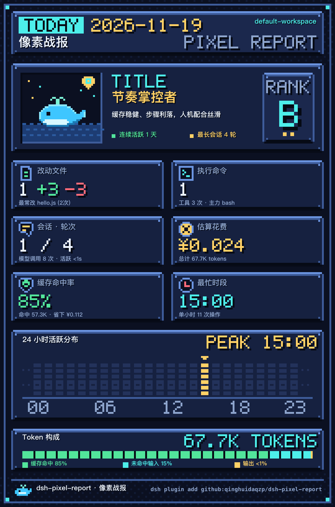

# dsh-pixel-report · 像素战报

[English](README.en.md) | 中文

DeepSeek Harness（`dsh`）右侧栏插件：**把 Agent 一天或一周干的活做成一张复古像素风战报卡片**，一键下载 1080×1632 高清 PNG 或复制到剪贴板，适合发朋友圈、小红书或团队群。




截图来自真实 `dsh`（`0.2.2-rc.1`）Web 界面测试环境：模型接入本地的 DeepSeek 替身（`test/mockseek.mjs`），在聊天里依次执行了写文件、改文件和跑终端命令等真实工具调用。

## 卡片上有什么

所有数字都来自真实记录，不造假、不随机：

- **像素鲸角色与评级**：根据当日/本周真实工作量算出 RPG 评级（`S+` / `S` / `A` / `B` / `C`，无活动时为 `ZZZ`）和专属像素挂件与称号（确定性规则，相同数据永远得到相同称号）。
- **改动文件与增删行数**：统计改过的文件数、增删行（`+added -deleted`）以及最常编辑的文件名（默认只显示文件名，不含目录路径）。
- **执行命令与工具调用**：统计终端命令次数（`bash` / `pwsh` / `terminal` 等）、工具调用总数和主力工具。
- **会话与轮次**：统计会话数、完成轮次、模型请求次数、活跃耗时、连续活跃天数和最长会话轮次。
- **花费与缓存省钱**：按 DeepSeek 官方峰谷价估算花费，并展示缓存命中率、缓存省下的金额和 Token 构成进度条。
- **活跃柱状图**：今日视图显示 24 小时像素柱状图并标出最忙时段；本周视图显示近 7 天活跃趋势柱状图。
- **3 套复古像素配色**：深海（DeepSea）、掌机（GameBoy）、街机（Arcade），一键切换。
- **一键导出**：支持「下载 PNG」（1080×1632 竖图，手机分享不糊）和「复制图片」（剪贴板不可用时自动提示改用下载）。

## 称号规则（确定性）

按以下顺序匹配第一条满足条件的规则，同一份统计数据永远产出同一个称号：

| 称号 | 触发条件 |
|---|---|
| 像素鲸打盹中 | 当前时段无请求、无工具调用、无轮次 |
| 夜猫子工程师 | 22:00–04:59 操作占比 ≥ 40%，或最忙时段落在 23:00–04:59 |
| 破晓卷王 | 05:00–08:59 操作占比 ≥ 45%，或最忙时段落在 05:00–08:59 |
| 重构狂魔 | 增删总行数 ≥ 400 且删行 ≥ 120，或删行 ≥ 60 且删行 ≥ 增行 |
| 省钱大师 | 缓存命中率 ≥ 85% 且省下 ≥ ¥0.50，或命中率 ≥ 90% 且提示词 ≥ 10K |
| 命令行战神 | 命令次数 ≥ 10 且占全部工具调用 ≥ 45% |
| 高产代码机 | 新增代码 ≥ 250 行，或改动文件 ≥ 8 个 |
| 持久战专家 | 最长单会话 ≥ 10 轮，或总轮次 ≥ 20 轮 |
| 节奏掌控者 | 缓存命中率 ≥ 70% 且模型请求 ≥ 4 次 |
| 稳健推进者 | 其他有真实活动的情况 |

## 数据从哪里来

插件后台只做**只读旁观**，不修改任何模型请求或工具结果：

- `llm/stream`：读取每次模型调用结束时的 `usage` 统计（输入、缓存命中、缓存写入、输出 Token）并按价格表换算费用与省下的金额。
- `tools/result`：统计实际执行的工具调用（自动跳过被审批拒绝或未派发就取消的调用）、终端命令次数，以及 `write` / `edit` / `apply_patch` / `str_replace_editor` 的文件与增删行统计。
- `session/event`：统计 `turn/start`、`turn/end` 的轮次与耗时；若当前环境启用了 `@deepseek-ai/dsh-workspace-changes`，还会监听 `workspace/changes` 事件，把通过终端命令改动的文件和 Git 净行数合并进来，并与文件工具记录去重，避免重复计数。

统计数据按本地日历日（保留最近 90 天）持久化在 dsh 主目录下的 `pixel-report/stats.json`，通过 `pixelReport` RPC 服务提供给右侧栏。

## 隐私

- 所有数据只保存在本机，插件**不联网**，不上传任何统计或图片。
- **不保存完整路径**：落盘的 `stats.json` 里只保留路径短哈希和文件名（basename），绝不记录目录结构；不保存任何对话内容、代码内容或命令参数。
- 卡片默认只显示最常编辑文件的文件名和工作区目录名；可以随时在侧栏勾选「**隐藏文件名**」，或在插件配置里把 `hideNames` 设为 `true`，卡片上会完全隐去文件名与工作区名。

## 价格说明

内置 DeepSeek 官方价格（2026-11-19 在 api-docs.deepseek.com 核对），单位为元 / 百万 token（空闲时段）：

| 模型 | 缓存命中输入 | 缓存未命中输入 | 输出 |
|---|---|---|---|
| deepseek-flash | 0.02 | 1 | 4 |
| deepseek-v4-pro | 0.15 | 4.5 | 13.5 |

工作日 9–12 点、14–18 点（北京时间）为高峰时段，价格翻倍（未区分法定节假日）。如官方调价或使用其他模型，可在配置里自定义 `prices`。

## 安装

需要 `dsh` ≥ 0.2.0，已在 `0.2.2-rc.1` 上完成实测。

```bash
dsh plugin --profile web add github:qinghuidaqzp/dsh-pixel-report
```

装好后重启 dsh，打开右侧栏，在引导页点击 **像素战报** 即可。

## 配置

```yaml
- id: pixel-report
  config:
    hideNames: false
    peakPricing: true
    prices: []
```

| 键 | 默认值 | 说明 |
|---|---|---|
| `stateFile` | dsh 主目录下的 `pixel-report/stats.json` | 统计数据保存路径；留空则仅保存在内存 |
| `hideNames` | `false` | 为 `true` 时卡片默认隐藏文件名与工作区名 |
| `peakPricing` | `true` | 是否按 DeepSeek 峰谷时段（北京时间工作日 9–12、14–18 点翻倍）估算费用 |
| `prices` | `[]` | 自定义价格表（每项含 `match` 正则、`label`、`hit`、`miss`、`output`） |

## 已知局限与实测说明

- **已验证**：纯逻辑单元测试（计价、行 diff、确定性称号、跨午夜分桶、隐私脱敏、`workspace/changes` 去重合并）；真实 `dsh 0.2.2-rc.1` headless 端到端测试（`write` + `edit` + `bash`）；真实 `dsh 0.2.2-rc.1` Web 界面在无头 Chrome 中验证右侧栏加载、实时统计刷新、今日/本周切换、3 套主题切换、隐私开关与 1080×1632 PNG 导出。
- **未在真实环境中直接验证**：非本地 `https`/`localhost` 或桌面端壳子下的剪贴板 `ClipboardItem` 写入权限（若浏览器限制，会降级提示改用「下载 PNG」）；真实 DeepSeek 在线 API 账号（测试使用本地替身 `test/mockseek.mjs`）。
- 仅统计通过 dsh 发起的请求和工具调用，不会统计其他客户端的用量；费用为按公开价目表的估算值，以账单为准。

## 开发与测试

```bash
npm install
npm test
```

端到端集成测试（无需 API Key，使用本地 `test/mockseek.mjs` 驱动真实 `dsh`）：

```bash
DSH_BIN=$(which dsh) node test/integration/run.mjs
```

## 许可证

MIT
